<!-- Tüm kartlar cards/*.svg; gen-cards.js ile üretilir (istatistikler GitHub API'den). -->

<a href="https://ensomg.com"></a>

  
  
  
  
  
  
  <a href="https://buymeacoffee.com/ensomg"></a>



  <a href="https://github.com/ensomg/Cobalt"></a>
  <a href="https://github.com/ensomg/dpiguard"></a>
  <a href="https://github.com/ensomg/listify"></a>
  <a href="https://github.com/ensomg/clawdai-chatbox"></a>
  <a href="https://github.com/ensomg/portfolio"></a>
  <a href="https://github.com/ensomg/roblox-anti-afk-kick"></a>


<a href="https://discord.gg/4pm"></a>

<!-- Canlı sayaç: ensomg-visits (Vercel) — hits.sh sayısını (+12381) kart tasarımında çizer. -->

